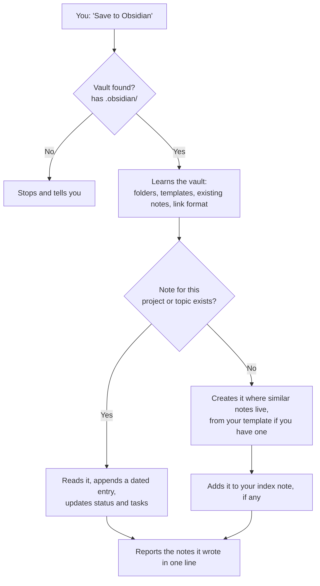

# magi-obsidian

A small Claude Code plugin that saves the work you do in Claude Code to your Obsidian vault, written the way your vault is already written.


You made a decision in a session, approved a plan or finished some research. Say "save to Obsidian": Claude looks at how your vault is organized, finds the right note (or creates one in the right place, from your own template), adds the decision and its reasoning, and tells you every file it wrote in one line.

---

## Contents

- [Why](#why)
- [Features](#features)
- [How it works](#how-it-works)
- [Install](#install)
- [Usage](#usage)
- [It follows your vault](#it-follows-your-vault)
- [Example output](#example-output)
- [Configuration](#configuration)
- [What gets written](#what-gets-written)
- [Limitations](#limitations)
- [Update and uninstall](#update-and-uninstall)
- [Project structure](#project-structure)

## Why

Most Claude plugins for Obsidian bring their own system into your vault: their folder layout, their note templates, plus transaction logs, ledgers, inbox folders and cache notes. The vault turns into the plugin's workspace.

magi-obsidian brings no system. It reads your folders, your templates and your existing notes, and writes new notes the way you would have. The whole plugin is one instruction file: no code, no scripts, no server, nothing to install in Obsidian.

## Features

| Feature | What it means |
|---|---|
| **One command** | `/magi-obsidian:save`, or plain language: "save to Obsidian", "write this to my vault", "take a note of this" |
| **Your folders** | New notes go where notes like them already live |
| **Your templates** | Uses your templates folder (core Templates or Templater) and fills in the placeholders |
| **Your style** | Copies frontmatter properties, heading names, heading language and date format from your existing notes |
| **Your link format** | Wikilinks or markdown links, following the vault's "Use [[Wikilinks]]" setting |
| **Index notes** | Adds a line to your home, index or map-of-content note when one lists notes like it |
| **No duplicates** | Finds an existing note first (name, folder, `aliases`) and updates it instead of opening a second one |
| **Hand edits are safe** | Reads a note before changing it; only appends or updates the parts it wrote |
| **Topic notes** | Decisions longer than a few paragraphs get their own note, linked from the project note |
| **Any language** | Writes in the language you speak, or the vault's language if your notes use another |
| **Absolute dates** | "Yesterday" or "last week" become real dates |
| **Selective** | Decisions, session summaries and research are saved; intermediate steps and dropped approaches are not |
| **Privacy** | Passwords, API keys, tokens and personal data are never written to a note |
| **Clear report** | After each save, the paths of every created and updated note in one line |
| **Zero dependencies** | Uses only Claude Code's own Write and Edit tools |

## How it works



## Install

Requires Claude Code 2.x.

**From GitHub:**

```bash
claude plugin marketplace add MagnusMagi/magi-obsidian
```

```bash
claude plugin install magi-obsidian@magi-obsidian
```

**From a local clone** (handy while you edit the plugin; changes apply from the next session):

```bash
git clone https://github.com/MagnusMagi/magi-obsidian.git
```

```bash
claude plugin marketplace add ./magi-obsidian
```

```bash
claude plugin install magi-obsidian@magi-obsidian
```

Check that it is installed:

```bash
claude plugin list
```

Then tell it where your vault is (see [Configuration](#configuration)). Nothing needs installing on the Obsidian side.

## Usage

In any Claude Code session, when the work is done:

```text
/magi-obsidian:save
```

or in plain language:

```text
Save to Obsidian
Write this decision to my vault
Add today's session to my notes
Save this research to Obsidian
```

You can also say what to save:

```text
Save to Obsidian: we picked SQLite for the database and dropped Postgres, because this is a single-user desktop app. Schema design is next.
```

When it is done, Claude reports in one line:

```text
Obsidian → Work/Atlas.md updated.
```

## It follows your vault

Before writing, the plugin looks at:

| It checks | And then |
|---|---|
| Top-level folders and where similar notes live | Puts the new note next to them |
| `.obsidian/templates.json`, Templater's settings, or a `Templates` folder | Fills in the matching template, placeholders included |
| One or two existing notes of the same kind | Uses the same properties, headings, language and date format |
| `useMarkdownLinks` in `.obsidian/app.json` | Writes `[[Note]]` or `[Note](Note.md)` links |
| A home, index or map-of-content note | Adds a line for the new note |

### Empty vault

Only when there is nothing to follow, it starts with a light default you can change any time:

```text
<vault>/
├── Projects/
│   └── Atlas/
│       ├── Atlas.md                 project note: summary, Status, Open tasks, Log
│       └── Atlas design decisions.md
└── Resources/
    └── SQLite vs Postgres.md        research not tied to a project
```

Once your vault has its own notes, those win.

## Example output

In an empty vault, `Projects/Atlas/Atlas.md` after a single "save to Obsidian":

```markdown
---
created: 2026-11-11
updated: 2026-11-11
tags: [project]
---

# Atlas

A single-user desktop app.

## Status

- Database chosen: SQLite.
- Schema design is next.

## Open tasks

- [ ] Schema design

## Log

### 2026-11-11 Database decision

- Decision: SQLite for the database (why: single-user desktop app).
- Ruled out: Postgres (no need for a database that runs a server).
- Next: Schema design.
```

In a vault with a project template, the same save fills in that template instead, with your headings and properties.

## Configuration

| Setting | Required | Description |
|---|---|---|
| `OBSIDIAN_VAULT` | no | Absolute path to the Obsidian vault to write to |

Put it where Claude Code can see it. The easiest place is the `env` block in `~/.claude/settings.json`:

```json
{
  "env": {
    "OBSIDIAN_VAULT": "/Users/you/Notes/MyVault"
  }
}
```

If `OBSIDIAN_VAULT` is unset, Claude uses the current directory when it is a vault, and otherwise asks you for the path. If the folder has no `.obsidian/` directory, nothing is written, so notes never end up scattered in the wrong folder.

## What gets written

| Written | Not written |
|---|---|
| The chosen path, the options ruled out and why | One-line fixes |
| Approved plans and spec summaries | Approaches tried and dropped, intermediate steps |
| Session summary: what was done, what is left, what is next | Anything already in the code or git history |
| Research findings with their sources | Passwords, API keys, tokens, personal data |

The plugin writes only verified information. A detail it is unsure of (a number, a date, what a screen shows) is checked against its source or left out.

## Limitations

- **No automatic saving.** It runs only when you ask; it does not write at the end of a session on its own.
- **No read or search command.** To look something up in the vault, ask Claude to read the folder.
- **One vault at a time.** Switch vaults by changing `OBSIDIAN_VAULT`.
- **No connection to the Obsidian app.** It writes files to disk; Obsidian picks up the changes by itself. Templater scripts are not run; Claude fills in their placeholders itself.
- **Wikilinks work in Obsidian only.** `[[Note]]` links do not render as links on GitHub.

## Update and uninstall

```bash
claude plugin marketplace update magi-obsidian
```

```bash
claude plugin uninstall magi-obsidian@magi-obsidian
```

```bash
claude plugin marketplace remove magi-obsidian
```

Uninstalling never touches the notes in your vault; they stay your files.

## Project structure

```text
magi-obsidian/
├── .claude-plugin/
│   ├── plugin.json          the plugin's name, version and description
│   └── marketplace.json     makes the repo a plugin marketplace of its own
├── skills/
│   └── save/
│       └── SKILL.md         all of the plugin's behaviour
└── README.md
```

To change how it behaves, edit [`skills/save/SKILL.md`](skills/save/SKILL.md).
